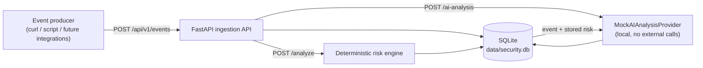

# AI Security Analysis Platform (POC)

A reusable, provider-neutral platform that accepts security events from multiple cloud and custom sources, stores them durably, calculates a deterministic and explainable risk score, and produces structured analysis and remediation guidance.

> **POC status:** local MVP only. No cloud resources are provisioned and no real AI model is called. The current "AI analysis" is produced by a **local, deterministic mock provider** (`provider: "mock"`). Vertex AI and live cloud integrations are planned for later phases.

---

## 1. Business problem

Security teams receive large volumes of alerts from GCP, AWS, Azure, and in-house tools, each in a different format. Triage is manual, slow, and inconsistent. This platform aims to:

- Speed up analysis and interpretation of security alerts.
- Improve the consistency and accuracy of risk assessment.
- Reduce manual investigation effort.
- Provide clear, actionable remediation recommendations.
- Improve visibility into overall security posture.
- Scale to large event volumes in later phases.

## 2. Architecture

### Current local MVP



### Target architecture (future phases; not implemented)

```
Security sources (GCP SCC / Cloud Logging / Cloud Monitoring /
                  AWS Security Hub / Azure Defender / custom)
  → Security event ingestion API
  → Persistent event store
  → Risk scoring engine
  → AI analysis (Vertex AI)
  → Recommendations
  → Response / remediation workflow
```

Risk scoring and AI analysis are deliberately separate. The deterministic risk score is authoritative, and AI analysis reads it but never changes it.

## 3. Technologies

| Area | Technology |
|---|---|
| Language / API | Python 3.14, FastAPI, Pydantic v2, pydantic-settings, Uvicorn |
| Persistence | SQLite (standard library `sqlite3`) |
| Container | Docker (multi-stage, `python:3.14-slim`, non-root UID/GID 1000) |
| Quality & security | Ruff, Pytest (+ `httpx2` for Starlette `TestClient`), Bandit, pip-audit |
| CI | GitHub Actions |
| Future | Vertex AI, Cloud Run, Security Command Center, AWS/Azure integrations |

## 4. Feature status

### Implemented and verified

Verified by the automated test suite **and** by a Docker end-to-end run (Tests A–G: health, ingestion, retrieval, risk, mock AI analysis, persistence across container restart, container health).

- Strict, canonical security-event schema. Unknown fields are rejected and timestamps must include a timezone.
- Normalized event-source values: `security_command_center`, `cloud_logging`, `cloud_monitoring`, `aws_security_hub`, `azure_defender`, `custom`. These are schema values only; there are no live connectors.
- Event ingestion (HTTP 202) and retrieval.
- Deterministic, explainable risk scoring (`low` / `medium` / `high` / `critical`) with factors and recommendations.
- Structured mock AI analysis: summary, threat explanation, potential impact, key observations, recommended actions, investigation steps, and limitations.
- SQLite persistence for events, risk assessments, and AI analyses. Data survives a container restart.
- Liveness (`/health`) and readiness (`/ready`) endpoints.
- Docker image running as non-root UID/GID 1000 with a Docker `HEALTHCHECK`.
- Local quality gates: compileall, Ruff, Pytest, Bandit, and pip-audit.
- GitHub Actions CI: green on commit `6a53868` (Ruff, `23 passed`, Bandit, pip-audit).

### Implemented but not yet fully verified

- Payload size limit (`MAX_EVENT_PAYLOAD_BYTES`). It is enforced only from the `Content-Length` header and has no dedicated test.

### Planned (not implemented)

See [Roadmap](#15-future-development-roadmap).

## 5. API endpoints

| Method | Endpoint | Purpose | Success |
|---|---|---|---|
| GET | `/` | Service name and version | 200 |
| GET | `/health` | Liveness check | 200 |
| GET | `/ready` | Readiness check | 200 |
| POST | `/api/v1/events` | Ingest a security event | 202 |
| GET | `/api/v1/events/{event_id}` | Retrieve an event | 200 |
| POST | `/api/v1/events/{event_id}/analyze` | Calculate and store the risk assessment (optional `RiskContext` body) | 200 |
| GET | `/api/v1/events/{event_id}/risk` | Retrieve the stored risk assessment | 200 |
| POST | `/api/v1/events/{event_id}/ai-analysis` | Generate and store a mock AI analysis (requires a risk assessment first) | 200 |
| GET | `/api/v1/events/{event_id}/ai-analysis` | Retrieve the stored AI analysis | 200 |

Interactive docs are served at `/docs` (Swagger UI) and `/redoc`.

Optional risk context for `/analyze`: `{"exploit_available": true, "active_exploitation": false, "sensitive_data": true}`.

## 6. Local setup (Ubuntu WSL)

```bash
cd ~/projects/security-ai-platform-clean
python3.14 -m venv .venv
source .venv/bin/activate
python -m pip install --upgrade pip
pip install -r requirements-dev.txt

# Run the API locally
uvicorn app.main:app --reload --host 127.0.0.1 --port 8080
```

## 7. Environment configuration

Settings are read from environment variables or a local `.env` file (never committed). Copy `.env.example` to `.env` to customise them.

| Variable | Default | Description |
|---|---|---|
| `APP_NAME` | `AI Security Analysis Platform` | Service name |
| `APP_VERSION` | `0.1.0` | Service version |
| `ENVIRONMENT` | `local` | Environment label |
| `LOG_LEVEL` | `INFO` | Log level |
| `MAX_EVENT_PAYLOAD_BYTES` | `262144` | Maximum accepted request size |
| `API_KEY_ENABLED` | `false` | Reserved for future use. Authentication is **not** implemented. |
| `DATABASE_PATH` | `data/security.db` | SQLite file (in Docker: `/app/data/security.db`) |

## 8. Database schema

Tables are created automatically at startup (`CREATE TABLE IF NOT EXISTS`). Each record is stored as validated JSON keyed by `event_id`.

| Table | Columns | Notes |
|---|---|---|
| `security_events` | `event_id` (PK), `status`, `received_at`, `event_json` | Index on `received_at` |
| `risk_assessments` | `event_id` (PK, FK → `security_events`), `assessment_json` | Latest assessment per event; `ON DELETE CASCADE` |
| `ai_analyses` | `event_id` (PK, FK → `security_events`), `analysis_json` | Latest analysis per event; `ON DELETE CASCADE` |

`data/*.db` and backups are git-ignored. To take a safe online backup while the app is running:

```bash
python - <<'PY'
import sqlite3, datetime
src = sqlite3.connect("data/security.db")
dst = sqlite3.connect(f"data/security-backup-{datetime.datetime.now():%Y%m%d-%H%M%S}.db")
src.backup(dst)
print(dst.execute("PRAGMA integrity_check").fetchone()[0])
PY
```

## 9. Docker

The image runs as user `app` with **UID/GID 1000:1000**, which matches the default WSL user. That lets the container write to the bind-mounted `data/` directory without changing host permissions. Before this was fixed, a UID 999 user caused `sqlite3.OperationalError: attempt to write a readonly database`.

```bash
# Build (use a new tag rather than overwriting existing ones)
docker build -t ai-security-platform:local-ai-analysis-uid1000 .

# Confirm the runtime user
docker run --rm --entrypoint id ai-security-platform:local-ai-analysis-uid1000
# uid=1000(app) gid=1000(app) groups=1000(app)

# Run with persistent data
docker run -d --name ai-security-platform \
  -p 8081:8080 \
  -e DATABASE_PATH=/app/data/security.db \
  -v "$HOME/projects/security-ai-platform-clean/data:/app/data" \
  ai-security-platform:local-ai-analysis-uid1000
```

If your host user's UID is not 1000 (check with `id -u`), the container will not be able to write to the bind mount. Adjust the Dockerfile UID/GID to match.

## 10. Health and readiness

```bash
curl -i http://127.0.0.1:8081/health    # {"status":"ok"}
curl -i http://127.0.0.1:8081/ready     # {"status":"ready"}
docker inspect -f '{{.State.Health.Status}}' ai-security-platform   # healthy
```

The Docker `HEALTHCHECK` polls `/health` every 30 seconds. `/ready` does not yet check database connectivity.

## 11. End-to-end example workflow

```bash
BASE=http://127.0.0.1:8081

# 1. Ingest an event -> 202 + event_id
EVENT_ID=$(curl -s -X POST "$BASE/api/v1/events" -H 'Content-Type: application/json' -d '{
  "source": "custom",
  "source_event_id": "demo-001",
  "event_type": "misconfiguration",
  "severity": "high",
  "title": "Storage bucket allows public read",
  "description": "A bucket policy grants allUsers read access.",
  "resource": {
    "provider": "custom",
    "resource_type": "storage.bucket",
    "resource_id": "demo-bucket",
    "internet_exposed": true,
    "business_criticality": "medium"
  },
  "observed_at": "2026-11-19T05:00:00Z",
  "evidence": {"policy_binding": "allUsers:objectViewer"}
}' | python3 -c 'import sys,json; print(json.load(sys.stdin)["event_id"])')

# 2. Retrieve it
curl -s "$BASE/api/v1/events/$EVENT_ID"

# 3. Risk assessment -> e.g. risk_score 70, risk_level "high"
curl -s -X POST "$BASE/api/v1/events/$EVENT_ID/analyze"
curl -s "$BASE/api/v1/events/$EVENT_ID/risk"

# 4. Mock AI analysis -> provider "mock"
curl -s -X POST "$BASE/api/v1/events/$EVENT_ID/ai-analysis"
curl -s "$BASE/api/v1/events/$EVENT_ID/ai-analysis"
```

Scoring for this example: severity `high` (+55), business criticality `medium` (+5), and internet exposed (+10) give a total of **70 → high**. Level thresholds: ≥80 critical, ≥60 high, ≥30 medium, otherwise low. The score is capped at 100.

## 12. Tests and security scans

```bash
source .venv/bin/activate
python -m compileall -q app tests
ruff check .
pytest -q
bandit -q -r app
pip-audit -r requirements-dev.txt
```

Last local result: compileall OK, Ruff `All checks passed!`, `23 passed` with no warnings, Bandit clean, and pip-audit `No known vulnerabilities found`.

## 13. CI workflow

`.github/workflows/ci.yml` runs on every push and pull request to `main`. It uses `ubuntu-latest` with Python 3.14 and read-only `contents` permission, using `actions/checkout@v7` and `actions/setup-python@v7` (Node 24), and runs these steps:

1. Install `requirements-dev.txt`
2. `ruff check .`
3. `pytest`
4. `bandit -q -r app`
5. `pip-audit -r requirements-dev.txt`

There is **no** CD pipeline and no cloud deployment.

## 14. Known limitations

- **AI analysis is mocked.** The output is template-based and deterministic, and no LLM or Vertex AI call is made. It must not be treated as independent threat intelligence.
- **No live cloud integrations.** The source values are schema values only, and events must be pushed to the API.
- **No authentication or authorization.** `API_KEY_ENABLED` is a placeholder and is not enforced.
- SQLite is single-node and suits a single container or low concurrency, not horizontal scaling.
- Only the latest risk assessment and AI analysis are kept per event; there is no history.
- No idempotency or deduplication on `source_event_id`, and no rate limiting.
- `/ready` does not check database health.
- No audit logging, data retention policy, or evidence redaction.
- The payload size check relies on the `Content-Length` header.

## 15. Future development roadmap

Not started. Each phase requires explicit approval before any cloud resources are created or paid services are used.

1. Real AI analysis using Vertex AI, behind the existing provider interface.
2. GCP Security Command Center integration.
3. Cloud Logging and Cloud Monitoring integrations.
4. AWS Security Hub integration.
5. Azure Defender integration.
6. Authentication and authorization.
7. Audit logging.
8. Security remediation workflows.
9. Response automation.
10. Production-oriented Cloud Run deployment.
11. Scalable event processing (for example, Pub/Sub and a managed database).
12. End-to-end demonstration.

## Cloud deployment

Not configured and not deployed. Do not run Terraform or create cloud resources until the GCP project, billing, IAM, region, and expected costs have been reviewed and explicitly approved.
